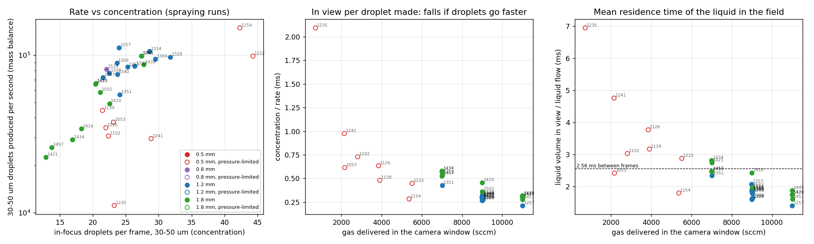

# Droplet production rate: investigation (CCD day, 2026-10-12)

Phase 8 of the CCD follow-up plan (`2026-10-13_CCD_followup_plan.md`, Phase B). Read-only: nothing on
the LaCie was written. Liquid stage 2.3.0 outputs (window drops masked, volumes). Files:
`2026-10-13_droplet_rate_investigation/` (CSV, figures, scripts).

## The question

"In-focus droplets per frame" (and the 30–50 µm band count) is a **concentration**: droplets made per
second × the time each spends in view × the share that is in focus. A faster spray reads lower for the
same production. Is that bias big enough on the CCD day to change which runs look best, and can a rate
be measured instead?

## B1. Mass-balance rate (from data the app already has)

Per run:

- Q_L = syringe flow (mL/min, from the feed steps/s);
- Q_atom = Q_L × atomised fraction **by volume** (2.3.0);
- v̄ = π/6 ⟨d³⟩ over the in-focus droplets;
- **Ṅ = Q_atom / v̄** droplets produced per second, and Ṅ_band = Ṅ × (share of in-focus droplets in 30–50 µm).

A second, simpler number comes from the same mass balance: **t_liquid = (mean liquid volume in view) / Q_L**.
This is the mean time the liquid spends in the field, if the whole spray cross-section is in the frame.
It needs no droplet sizes at all.

(`concentration / rate` = band_pf / Ṅ_band is t_liquid × the in-focus share of droplet volume, median
0.17. It is not independent of t_liquid: same information, droplets only.)

### What it shows

**1. Gas makes droplets faster, and the per-frame count hides it.** Along the 1.2 mm gas axis
(500 rpm, feed 4,000; flow-controlled):

| Gas delivered (sccm) | In-focus 30–50 µm per frame | Ṅ_band (droplets/s) | t_liquid (ms) |
|---|---|---|---|
| 7,009 (135146) | 24.1 | 56,000 | 2.34 |
| ~9,000 (5 centres) | 21.5–27.3, mean 24.8 | 72,000–99,000, mean 86,000 | 1.6–2.1, mean 1.8 |
| 11,011 (125754) | 24.0 | 112,000 | 1.41 |

The concentration is flat. The rate doubles. t_liquid falls 1.66× for 1.57× the gas: the liquid leaves
the field in proportion to the gas flow.

**2. Residence time follows delivered gas across both regimes** (right panel). The pressure-limited
0.5 mm runs fall on the same curve once plotted against the gas they actually got (2.4–12 ms at
700–5,500 sccm). Spearman t_liquid vs delivered gas: −0.81 on all spraying runs, −0.75 on the
flow-controlled ones.

**3. The rate re-ranks the runs.**

- Ṅ_band vs band per frame: Spearman 0.84 (flow-controlled, n = 23), 0.70 (all 31 spraying runs).
- Biggest moves (flow-controlled, rank by concentration → rank by rate):

  | Run | Change |
  |---|---|
  | 125754 (11,000 sccm, 1.2 mm) | #10 → **#1** |
  | 130918 (centre) | #12 → #7 |
  | 135146 (7,000 sccm, 1.2 mm) | #9 → #18 |
  | 141052 (centre, 1.8 mm) | #13 → #19 |
  | 132817 (0 rpm control) | #1 → #5 |

- Best 5, flow-controlled:
  - by concentration: 132817, 130400, 131450, 143939, 145142;
  - by rate: 125754, 131450, 145142, 134610, 132817.

  Three of the five are shared.

**4. Area- vs volume-based Ṅ:** Spearman 0.91 (flow-controlled). The volume correction moves the scale,
not much the order (as in the area-vs-volume note).

**5. Order of magnitude.** t_liquid is 1.4–2.8 ms on the flow-controlled runs, **shorter than the
2.56 ms between frames**. The flow runs down the image's short side (11.52 mm; B2), so that is a mean
liquid speed of about **4–8 m/s** (8.2 m/s at 11,000 sccm, 4.9 m/s at 7,000; 1.2 mm). Consecutive
frames at 390 fps should therefore see different liquid, which B2 confirms.

### Assumptions and limits

- **The whole spray crosses the frame.** If the spray is wider than the field, the volume in view is
  low, so t_liquid is short and the speed high. The ranking across runs is unaffected unless spray
  width changes with the factors.
- **Volume is good to about ±40% absolute** (round cross-section; ribbon 0.6×). Ratios between runs
  are better (round vs ribbon Spearman 0.999). See `2026-10-13_area_vs_volume_and_window.md`.
- **The in-focus size distribution stands for all droplets.** v̄ = π/6 ⟨d³⟩ is dominated by the
  largest droplets, which are the worst sampled, so Ṅ inherits their noise. Ṅ_band shares that
  denominator.
- **One station, one window.** Droplets that coalesce or evaporate before the window are not counted.

## B2. Velocity directly from the cines

Full note: `2026-10-13_droplet_rate_investigation/b2/B2_velocity_feasibility.md` (figures, summary CSV,
scripts; the 1.1 GB frame cache and per-object dumps stayed in the session scratchpad). 250
consecutive frames were read straight from the cines of three 1.2 mm runs that differ only in gas
(7,000 / 9,000 / 11,000 sccm), plus the C3 dribble as a slow positive control.

**The 390 fps cines cannot give velocity.**

- **Nothing pairs across one frame (2.56 ms).** Three methods all sit at the level of unrelated frames
  (k vs k+50) in all three runs:
  - PIV-style ensemble correlation: a 6–9 sd peak for k→k+1, against 6–9 sd for the controls, at
    random offsets that disagree between bursts;
  - nearest-neighbour blob matching: 0.2–0.3% of droplets have a partner within 10 px, which is
    chance;
  - persistence directly below each droplet: at most 3–12 re-seen per pair, where 31–35 would be if
    they moved at 2 m/s.

  The same code gives 154 sd and 87% persistence on the slow C3 mist. It also recovers a planted shift
  when only 5% of droplets persist. So the null is real.
- **Motion blur at 4 µs is too small.** In-focus droplets are slightly elongated about 15° off the
  flow axis. The elongation is the same at all three gas flows and is present in near-stationary
  dribble droplets, so it is optical (probably astigmatism). The bound it gives is v ≤ ~4 m/s for
  detected sharp droplets (≤ 6 m/s uncorrected): no per-run value and no gas trend.
- **Flow direction:** downward, along the image's short side (11.52 mm).

**What a velocity measurement would need** (B2 §5 has the settings and the arithmetic):

1. **First, 10 minutes on the current setup:** an exposure series at 9,000 sccm and 390 fps, with
   exposures of 1, 4, 16 and 40 µs.
   - If the along-flow streak grows with exposure, streak length gives velocity full-field, with no
     new hardware (at 16 µs, 1 px = 0.6 m/s).
   - Comparing counts at 1 and 4 µs also tests whether fast droplets are being lost to blur now.
2. **Windowed PTV:** about 50 kfps (Δt 20 µs), a 512 × 128 window with the camera rotated 90° so the
   flow runs along it, and a 1 µs exposure (about ¼ of the light). This gives 4–50 px displacement at
   2–25 m/s. The window sizes are estimates; PCC shows the true maximum rate.
3. **Routine flux in every run:** a double-pulsed backlight. Two ≤ 0.5 µs pulses 10–20 µs apart inside
   one exposure give a pair image of every droplet at full field and 390 fps. It needs a pulsed LED
   driver. Frame-straddling support on the VEO-E 340L is unconfirmed.

**B1 and B2 disagree mildly.** The mass balance gives 4–8 m/s mean liquid speed, while the blur bound
is ≤ ~4 m/s for *detected sharp* droplets. Three things could explain it:

- detection selects slow droplets (fast ones blur and fail the sharpness rule, the 2.2.0 effect that
  already removes more droplets at high gas);
- the spray is wider than the frame, which makes t_liquid short;
- the ±40% volume calibration.

The exposure series separates these.

## Side finding: frames are independent samples of transit

No droplet survives one frame interval, and liquid crosses the field in 1.4–2.8 ms. The ~20 ms
decorrelation time in `docs/definitions.md` (20.5 mm ÷ ~1 m/s) is therefore wrong for transit.
Corrected there (2026-10-13). Consequences:

- Any count correlation between analysed frames is **pulsing** (intermittency), not the same droplets
  seen twice. So lag-1 measures what it is meant to.
- The stride-10 CI is conservative for transit. Intermittency now sets the decorrelation, and a block
  bootstrap on the measured autocorrelation is still the right fix.

## Conclusion

1. **The per-frame count is a concentration, and on this rig that matters.** Gas speeds the liquid up
   in proportion to the flow. So the in-focus count stays flat along the gas axis while the
   mass-balance production rate doubles. A count goal therefore under-rewards gas, and rate and
   concentration re-rank the runs (Spearman 0.84; 11,000 sccm 1.2 mm goes from #10 to #1).
2. **Velocity can't come from the existing cines.** It needs a new capture. The cheapest test is a
   10-minute exposure series.
3. **A rate is available now from the mass balance:** Ṅ_band = Q_L × atomised-by-volume × band share ÷
   π/6⟨d³⟩. It uses only data the app already has. Its weak points are the volume calibration
   (±40% absolute, ranking good) and v̄'s dependence on the large-droplet tail.

**Ben's decision:**

- (a) add Ṅ_band (and Ṅ) to the app as opt-in responses labelled "estimated by mass balance";
- (b) the exposure series on the next rig day;
- (c) plan a windowed PTV capture or a pulsed backlight.

**Decided 2026-10-13 (Ben):** (a) done: `rate` / `rate_band` are opt-in responses; (c) planned: `docs/VELOCITY_CAPTURE_PLAN.md` (exposure series first, then a 15-capture calibration set on a narrow high-fps window, fitted and applied to every run).

**Recommendation (as written):** (a) + (b). (a) costs about an hour with tests, follows the pattern of the
band-count response, and makes the count-vs-rate difference visible in the next analysis. (b) is ten
minutes and tells us whether (c) is needed and whether high-gas droplets are being lost.
