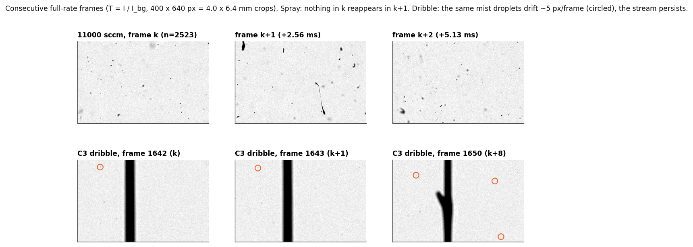
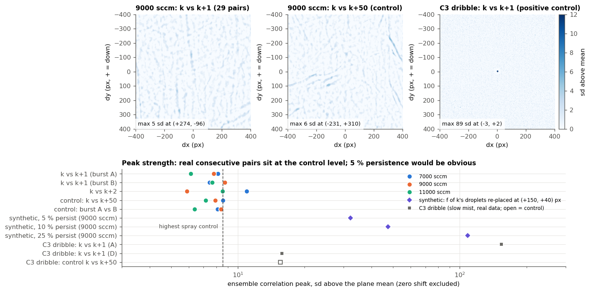
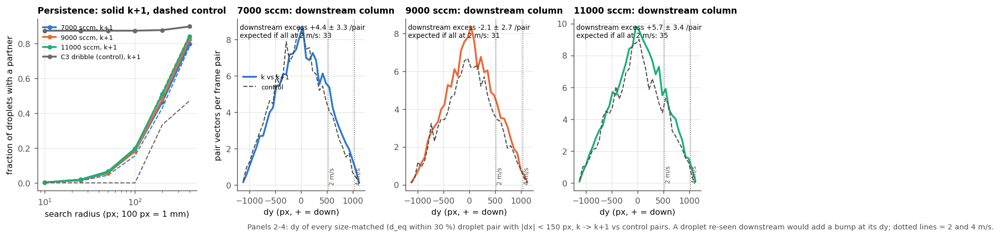
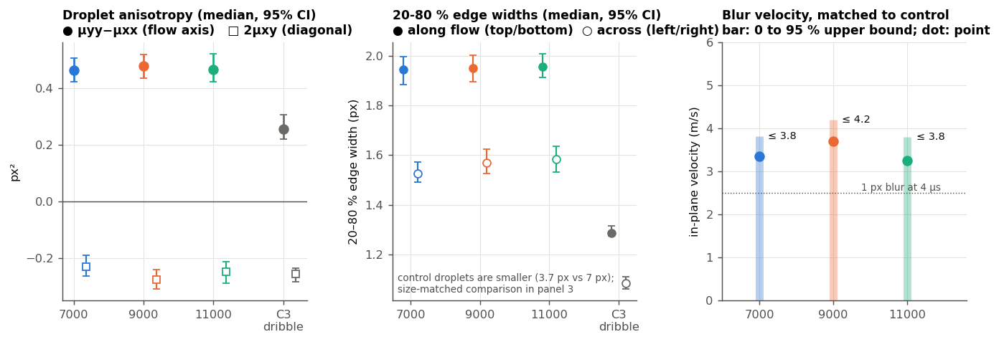
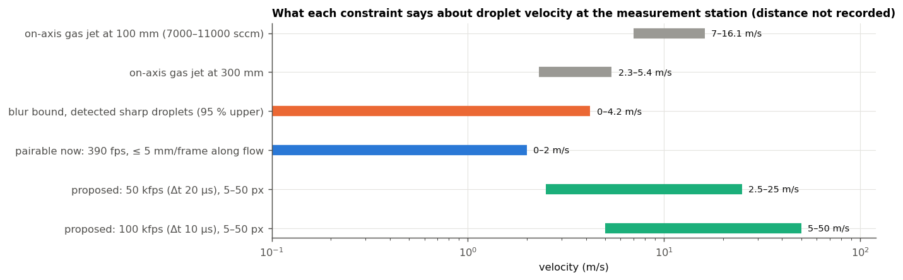

# B2: can the existing cines give droplet velocity?

2026-10-13. Read-only feasibility study on the CCD day (2026-10-12) cines. Nothing on the LaCie or in
the repo was written or changed; everything is in this folder.

## Answer

**No. The 390 fps cines cannot give velocity, so a flux response cannot be built from them.**

- Consecutive frames (2.56 ms apart) share no droplets. PIV-style correlation, blob matching and
  persistence all sit at the level of unrelated frames (k vs k+50, or 1.5 s apart) in all three gas
  runs. The same code locks onto real motion in the slow C3 dribble run, and recovers a synthetic shift
  when only 5 % of droplets persist. So the null result is real, not a failure of the method.
- Motion blur at 4 µs is too small to measure velocity. The sharp in-focus droplets have an
  along-flow elongation that is the same at 7000, 9000 and 11000 sccm (difference between 11000 and
  7000: +0.001 [−0.064, +0.068] px²). Most of it is also present in near-stationary droplets, so it is
  optical. That only gives an **upper bound of ≤ ~4 m/s** (95 %, after subtracting the optical part)
  or **≤ ~6 m/s** (with no correction at all) for the droplets that are detected. It gives no per-run
  value and no trend with gas flow.
- From the flow rates, the on-axis gas velocity is 7–16 m/s at 100 mm below the orifice and still
  2–5 m/s at 300 mm. To be pairable at 390 fps a droplet must be below ~2 m/s. The stand-off distance
  is not recorded, but the dribble stream crosses the field, so the field is near the axis.
- **A new capture is needed.** Cheapest first: an exposure series on the current setup. The real
  measurement: a windowed PTV capture at ~50 kfps (Δt = 20 µs), 1 µs exposure, with the flow along
  the long side of the window. The routine-flux route: a double-pulsed backlight. Settings are in §5.

---

## 0. Data, geometry, what was read

| run tag | run folder | gas set / delivered (sccm) | P0 in camera window (barA) |
|---|---|---|---|
| low | `135146_7000sccm_500rpm_4000sps_or1.2_bh0.5` | 7000 / 7015 | 2.76 |
| centre | `130918_9000sccm_500rpm_4000sps_or1.2_bh0.5` | 9000 / 9002 | 3.06 |
| high | `125754_11000sccm_500rpm_4000sps_or1.2_bh0.5` | 11000 / 11011 | 3.32 |
| control | `112022_11000sccm_100rpm_5000sps_or0.5_bh0.5` (C3, gas-starved dribble, 33 sccm delivered) | — | — |

- Cine: 1152 rows × 2048 columns, uint16 (12-bit), 390 fps, 4 µs exposure, frames −1…5069. Read with
  `cine_reader.Cine` → `cine.load_frame(n); np.asarray(cine.frame)`, the same calls as
  `cine_extract.py`. T = frame / `background_median.tiff`.
- Frames read: per spray run, burst A = 2500–2529 (30 consecutive), burst B = 1000–1019 (20),
  C = 2550–2559 (10, the k+50 control for A). For the dribble: A, C, and D = 1630–1659 (its densest
  droplet period in `per_frame.csv`). **250 frames in total**, about 0.25 s per frame.
- **Flow axis = image vertical, flowing downward.** In the sprays, ligaments with aspect ratio above 4
  have a signed median angle of 0.2° / −0.2° / −1.5° from vertical (IQR ±20–25°). 74–79 % of the
  near-vertical ones carry their mass at the bottom with the tail pointing up. In the dribble, two
  liquid threads run the full frame height, exactly vertical (0.3°), at x ≈ 1100 and 1600 px, so the
  nozzle axis passes through the field. The along-flow extent of the field is therefore the **short**
  side, 1152 px = 11.52 mm.
- In-focus droplet blobs used here: seed T < 0.6, grown to T < 0.85, d_eq 2–30 px, off the border.
  That gives 50–70 per frame. No static specks were found (none recur at the same place in ≥ 50 % of
  a burst).

## 1. Frame-to-frame correspondence

**1a. PIV-style correlation** (`piv.py`). The signal is (1 − T / burst-median T), high-passed with a
10 px Gaussian, which removes static residue. Three versions:

- Whole frame, overlap-normalised NCC over |dy| ≤ 560 px (5.6 mm, i.e. ≤ 2.2 m/s vertical) and
  |dx| ≤ 1000 px.
- 256 px interrogation windows (4 × 8 of them), searching ±64 px.
- An ensemble correlation: planes summed over all pairs, which is the sparse-PIV way to pull out a
  weak but consistent displacement.

| | 7000 | 9000 | 11000 | C3 dribble |
|---|---|---|---|---|
| ensemble peak, k→k+1 (sd above plane), burst A / B | 8.1 / 7.5 | 7.8 / 8.7 | 6.1 / 7.7 | **153.7** / 15.8 |
| location of that peak (dy, dx px), A / B | (−296, 287) / (−234, −971) | (430, −603) / (545, −153) | (113, 41) / (−89, 177) | (−3, 2) / (4, −1) |
| ensemble peak, controls k+50 / A-vs-B | 8.6 / 8.1 | 7.9 / 8.4 | 7.2 / 6.4 | 15.6 / 5.0 |
| whole-frame best NCC per pair, median, k+1 vs k+50 | 0.064 vs 0.057 | 0.063 vs 0.070 | 0.065 vs 0.077 | — |
| 256 px window peak NCC, median, k+1 vs k+50 | 0.079 vs 0.083 | 0.070 vs 0.067 | 0.078 vs 0.079 | — |

In the sprays, the k+1 peaks are the size of the control peaks and land at random places that do not
agree between bursts A and B.

**Positive controls.**

- The dribble's burst A, a slow mist drifting about 3 px per frame, gives a peak of 154 sd at
  (−3, +2), and k+2 doubles it to (−6, +4).
- Synthetic test: take frame k+1 of the 9000 sccm run and paste in a fraction f of frame k's blobs,
  shifted by (+150, +40) px. The ensemble peak comes out at exactly (150, 40), with SNR 32 / 48 / 109
  for f = 5 / 10 / 25 %. The highest spray control is 8.6.
- So **if even ~5 % of droplets were re-imaged with a common displacement, it would be obvious.**
- The dribble's burst D figure (15.8) is weak only because the vertical stream dominates its
  correlation plane (its own k+50 control is 15.6). Burst A is the clean case.

**1b. Blob matching** (`nn_match.py`, `nn_sector.py`):

- **All pairs.** All 2D displacement vectors from every droplet in k to every droplet in k+1, with
  sizes within ±30 %, binned at 32 px. Compared with k+50 and A-vs-B pairs (48 lag-1 pairs, 30
  control pairs per run). The largest excess over 9216 bins is z = 3.6 / 3.7 / 4.0, which is what
  chance gives over that many bins (~3.9), and it sits at unrelated places.
- **Downstream column.** Size-matched vectors with |dx| < 150 px and dy = +50…+1100 px, with the
  chance level taken from the flanking columns of the same pairs (this removes the frame-to-frame
  count correlation caused by pulsing). Excess re-seen per pair: **+4.4 ± 3.3, −2.1 ± 2.7,
  +5.7 ± 3.4** (95 % upper 10.9 / 3.2 / 12.3).
- If every droplet moved straight down at 2 m/s and stayed in focus, 33 / 31 / 35 per pair would be
  re-seen; at 3 m/s, 20 / 19 / 21.
- So **most droplets are not re-seen at ≤ 2 m/s.** At 3–4 m/s too few droplets stay in the 11.5 mm
  field for the test to say anything.

**1c. Persistence**: the fraction of droplets in k that have a size-matched partner in k+1 within r.

| r (px) | 10 | 50 | 100 | 200 |
|---|---|---|---|---|
| 7000, k+1 / control | 0.003 / 0.002 | 0.064 / 0.044 | 0.18 / 0.16 | 0.46 / 0.43 |
| 9000 | 0.003 / 0.001 | 0.056 / 0.054 | 0.18 / 0.20 | 0.48 / 0.52 |
| 11000 | 0.002 / 0.002 | 0.065 / 0.055 | 0.20 / 0.19 | 0.51 / 0.52 |
| C3 dribble | **0.87** / 0.00 | 0.87 / 0.00 | 0.87 / 0.00 | 0.88 / 0.33 |





**Conclusion of §1.** No droplet is re-imaged at 2.56 ms. In-plane motion of more than ~5 mm per frame
(over ~2 m/s) explains this. So do droplets leaving the focal slab between frames: a z-velocity of a
few tenths of a m/s moves them about a millimetre per frame, and the DOF is not calibrated. Either
way, the cines contain no displacement to measure.

## 2. Motion-blur bound (`blur.py`, `bounds.py`, `streak_profiles.py`)

At 4 µs, 1 px (10 µm) of streak is 2.5 m/s. Per isolated in-focus droplet (d_eq 3–25 px,
T_min < 0.5), two measures:

- **Grey-level second moments.** A box blur of length L along y adds L²/12 to μyy, so D_flow =
  μyy − μxx picks it up.
- **20–80 % edge widths** from interpolated T profiles: top and bottom edges (along flow) against
  left and right edges (across).

| | 7000 | 9000 | 11000 | C3 dribble (≈ zero velocity) |
|---|---|---|---|---|
| droplets measured | 1725 | 1650 | 1996 | 85 (≈ 9 distinct droplets, mm/s–cm/s drift) |
| median d_eq (px) | 7.0 | 7.0 | 7.1 | 3.7 |
| D_flow = μyy − μxx, median [95 % CI] (px²) | 0.463 [0.423, 0.506] | 0.478 [0.436, 0.519] | 0.464 [0.422, 0.521] | 0.254 [0.218, 0.306] |
| 2μxy (diagonal), median (px²) | −0.23 | −0.28 | −0.25 | −0.26 |
| edge width along / across (px) | 1.95 / 1.53 | 1.95 / 1.57 | 1.96 / 1.58 | 1.29 / 1.09 |
| axis of the anisotropy (° from vertical) | −13 | −15 | −14 | −23 |

- **The anisotropy is optical, not motion.** It is the same in all three gas runs. The near-stationary
  dribble droplets show it too, with the same diagonal term and the same tilted axis, about −15° from
  vertical, whereas the flow is at 0°. The likely cause is lens astigmatism.
- Faint, slightly defocused objects in both the sprays and the dribble are also elongated along that
  axis. I checked whether the faint "dashes" in the sprays are motion streaks. Zoomed in, they are
  mostly defocused blobs (`look/dash_zoom_*.png`), not uniform streaks with end ramps, and their
  elongation does not grow with gas.
- **Matched against the control** (d_eq 3–5.5 px, T_min 0.2–0.5; 550 / 532 / 634 spray droplets vs
  85 control), the spray D_flow is higher by +0.149 / +0.183 / +0.141 px².
- If all of that excess is blur: **L ≈ 1.3–1.5 px, i.e. v ≈ 3.2–3.7 m/s, with 95 % upper bounds of
  3.8 / 4.2 / 3.8 m/s.** It is an upper bound because fragment shape also contributes.
- With no optical correction at all, L ≤ 2.4 px, so v ≤ 6 m/s.
- The control rests on only ~9 distinct droplets, so its CI is optimistic. Treat "≤ ~4 m/s" as
  approximate.
- **No gas trend.** D_flow is flat across 7000→11000 sccm. If droplet velocity at the station scaled
  with gas flow, that flatness alone would bound v(9000) ≤ 2.4 m/s.
- **Selection caveat.** The bound applies only to droplets that pass detection. A 40 µm droplet at
  ≥ 10 m/s (L ≥ 4 px) is smeared to roughly half its contrast and would fail the T < 0.6 seed and the
  0.70 focus gate. A fast population could therefore be under-counted rather than measured. That bias
  would work in the same direction as the residence-time effect (fast sprays read low). It is
  untested. The exposure series in §5 settles it.



## 3. Physical order of magnitude (`physics.py`, `results/physics_estimates.csv`)

Inputs:

- N₂ at the Alicat's standard conditions (25 °C, 1 atm; 1.145 kg/m³).
- Liquid: 4000 steps/s ÷ 6800 steps/mm × π(20.27 mm / 2)² = **11.39 mL/min = 0.203 g/s**. The
  liquid-only velocity in a 1.2 mm orifice would be 0.17 m/s.
- Orifice area 1.131 mm².

| | 7000 | 9000 | 11000 |
|---|---|---|---|
| gas mass flow (g/s); GLR | 0.134; 0.66 | 0.172; 0.85 | 0.210; 1.03 |
| gas exit velocity at ambient density, Q/A (m/s) | 103 | 133 | 162 |
| same at P0 density (m/s) | 38 | 44 | 50 |
| ideal isentropic expansion from P0, gas alone (upper limit, m/s) | 393 | 410 | 422 |
| on-axis jet centreline at 50 mm (m/s) | 14–23 | 16–28 | 18–32 |
| at 100 mm | 7–12 | 8–14 | 9–16 |
| at 200 mm | 3.5–5.8 | 4.0–6.9 | 4.5–8.1 |
| at 300 mm | 2.3–3.9 | 2.7–4.6 | 3.0–5.4 |
| distance where the centreline falls to 2 m/s | 0.35–0.58 m | 0.40–0.69 m | 0.45–0.81 m |

How the jet rows were computed:

- Round turbulent jet, u_c = 6 √(4J / πρ_a) / x.
- Momentum flux J = (ṁ_g + ṁ_l) × exit velocity, bracketed by the two exit-velocity rows.
- Droplets of 40–100 µm have relaxation times of 5–30 ms, so downstream they lag the deceleration
  and run *faster* than the local gas, not slower.

**The measurement station's distance from the orifice is not recorded anywhere.** `docs/` lists it as
an open item: IMAGING_PIPELINE_REFERENCE §13 item 11. `run_summary.xlsx` has no field for it. Unless
the station is ≳ 0.35 m below the orifice, the expected droplet velocity is well above the ~2 m/s
pairability limit at 390 fps, which is consistent with §1.

## 4. What the existing data do and do not pin down



- The detected sharp droplets have in-plane velocity ≤ ~4 m/s (≤ 6 m/s with no optical correction).
  That is consistent with a station a few hundred mm downstream, or an off-axis or entrained
  population.
- Either they move fast enough (≳ 2–3 m/s) not to be re-seen, or they leave the focal slab between
  frames.
- **No per-run velocity, and no velocity ratio between runs, can be extracted.** The run-to-run ratio
  is exactly what a flux correction (count × v / field length) needs, so the flux response cannot be
  built from these cines.

## 5. New capture: settings and justification

**Pairability.**

- Droplet spacing at today's density is ~200 px (60 per 2.36 Mpx frame). Nearest-neighbour PTV with
  size matching is unambiguous for displacements up to ~50 px, and 3-frame tracks extend that.
- Target displacement: 5–50 px (50–500 µm), with the window's along-flow length ≥ 4× the largest
  displacement.
- For an expected 2–25 m/s (the blur bound plus the jet estimate):
  **Δt = 20 µs (50 kfps) gives 4–50 px.**
- Near the nozzle (≥ 25 m/s) use 100 kfps (Δt 10 µs, 5–50 px covers 5–50 m/s).

**Camera.**

- Phantom VEO-E 340L, 18 GB (`GUI_Clean.py:3111`, `:6033`).
- Published: 800 fps at 2560 × 1600, i.e. a throughput of **~3.2–3.3 Gpx/s**. A retailer lists
  1541 fps at 1920 × 1080, which is consistent with that. Minimum exposure 1 µs (VEO-E datasheet, as
  quoted in search results; I could not read the PDF table).
- **I did not find the full resolution-vs-rate table**, so the windows below are estimates at constant
  throughput. Small windows usually fall short of constant throughput because of per-frame overhead.
  **Type the window into PCC; it shows the true maximum rate.**
- Side fact: at the current 2048 × 1152, constant throughput allows ~1,400 fps. The 390 fps is set by
  wanting 13 s in 18 GB: 5071 frames × 3.5 MB is the whole memory.

| frame rate | Δt | px per frame at 3.2 Gpx/s (est.) | example window (along flow × across) | field | v range for 5–50 px | record time in 18 GB |
|---|---|---|---|---|---|---|
| 25 kfps | 40 µs | ~128 k | 1024 × 128 | 10.2 × 1.3 mm | 1.25–12.5 m/s | ~3.7 s |
| **50 kfps** | **20 µs** | **~64 k** | **512 × 128** | **5.1 × 1.3 mm** | **2.5–25 m/s** | **~3.7 s** |
| 100 kfps | 10 µs | ~32 k | 256 × 128 or 512 × 64 | 2.6 × 1.3 mm | 5–50 m/s | ~3.7 s |

- **Rotate the camera 90°** so the flow runs along the sensor rows. CMOS rate depends mostly on the
  row count, so a short, wide window is the fast one, and the window's long side then lies along the
  flow.
- **Exposure 1 µs.** At 20 m/s that is 2 px of blur, against ~8 px at today's 4 µs. It gives a
  quarter of today's light (background ~800 → ~200 of 4095 counts), so turn the backlight up or raise
  the gain, and check the background SNR before the run.
- Keep the focus, aperture and position exactly as in the CCD captures. Record the stand-off distance.
- Conditions: the three gas set points of this study (7000 / 9000 / 11000 sccm, 1.2 mm, 500 rpm,
  feed 4000), ~2–4 s each.
- Output per run: a velocity distribution of the axial component, and its ratio between runs.
- Flux = (in-focus count per frame) × v̄_axial ÷ (along-flow field length), per size class if the
  velocity depends on size.

**Do first (zero cost, ~10 min): an exposure series on the current full-field setup.** At 9000 sccm,
390 fps, record 1, 4, 16 and 40 µs (adjust gain so the background stays ~800–3000 counts), 1–2 s
each.

- If the along-flow elongation of in-focus droplets grows in proportion to the exposure, it is motion.
  The streak length then gives v directly: at 16 µs, 1 px = 0.6 m/s; at 40 µs, 0.25 m/s. That is
  full-field streak velocimetry with the existing pipeline and no new hardware. Only the sign is
  ambiguous, and the flow is known to be downward.
- If the elongation does not grow, velocities are ≲ 1 m/s, or detection is hiding the fast droplets.
  Comparing counts between 1 µs and 4 µs tests that selection bias directly.

**For a routine flux response in every run: a double-pulsed backlight.** Pulse the LED twice,
~0.3–0.5 µs each, Δt 10–20 µs apart, inside one ~25–40 µs camera exposure, triggered from the
camera's strobe / sync output.

- Every frame then holds an image pair of each droplet, at full 2048 × 1152 and 390 fps, so sizing and
  velocity come from the same capture.
- Cost: a pulsed LED driver.
- Phantom's PIV "frame-straddling" mode would also give a short inter-frame time. I could not confirm
  that the VEO-E supports it; ask Vision Research / AMETEK.

## 6. Side findings (not asked, but they change things)

1. **Transit decorrelation is under 2.56 ms, not ~20 ms.** No droplet survives one frame interval.
   `docs/definitions.md` ("Decorrelation time ~20 ms") and the stride / `ci_stride` reasoning rest on
   20 ms. Every 390 fps frame is a fresh droplet sample. The remaining frame-to-frame correlation in
   counts is pulsing, which the existing autocorrelation already measures. Worth a STATUS line.
2. **The optics have a fixed anisotropy.** In-focus droplets are elongated by ~0.25 px² (moment
   difference) along an axis ~15–20° off vertical, with 20–80 % edge widths 0.2–0.4 px wider along
   it. It is present with zero motion and the same in every run, so it is probably astigmatism. It is
   small for 7 px droplets, but it biases shape-based rejection of 3–4 px droplets slightly; a dot-grid
   or reticle check (§13 items 1–2) would show it.
3. **Possible velocity-dependent detection loss** (§2 caveat). It is plausible, untested, and testable
   with the exposure series.

## 7. Could not determine

- The stand-off distance (not recorded).
- The true DOF, so whether non-persistence is in-plane or out-of-plane motion.
- The VEO-E 340L's exact rate at small windows, and whether it supports frame straddling.
- Whether the backlight is continuous. I assumed it is, so the exposure is 4 µs. If it is already
  pulsed, the blur numbers scale with the pulse length.
- The velocity of droplets the 4 µs images may miss.

## Files and how to re-run

All files are in `/private/tmp/claude-501/-Users-benschofield-Documents-GitHub-HPATR/f64aefdf-b151-41e3-87ed-8f984dab7791/scratchpad/b2_velocity/`.

- `b2_summary.csv`: per-run numbers.
- `results/`: JSON / CSV / NPY intermediates, `physics_estimates.csv`, `piv_log.txt`.
- `figures/`: fig1–5.
- `look/`: quick-look renders and galleries.
- `cache/`: 1.1 GB of frames; delete it when done.

Re-run in this order (the `piv.py` step takes ~5 min):

```
D=/private/tmp/claude-501/-Users-benschofield-Documents-GitHub-HPATR/f64aefdf-b151-41e3-87ed-8f984dab7791/scratchpad/b2_velocity
PY=/Users/benschofield/anaconda3/envs/phantom/bin/python3
$PY "$D/fetch_frames.py" && $PY "$D/fetch_dribble_extra.py"
$PY "$D/piv.py" && $PY "$D/nn_match.py" && $PY "$D/nn_sector.py"
$PY "$D/blur.py" && $PY "$D/bounds.py" && $PY "$D/streak_profiles.py" && $PY "$D/streaks.py"
$PY "$D/physics.py" && $PY "$D/figures.py" && $PY "$D/summary_table.py"
```
