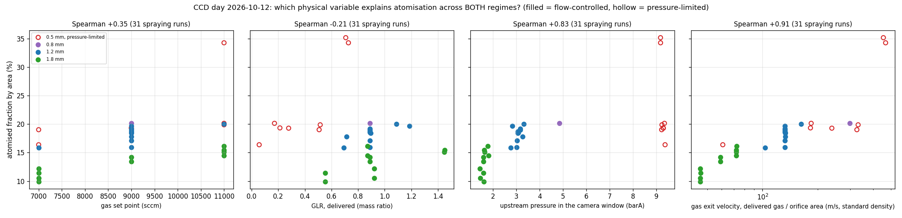

# Phase 12: set points or physical variables? (opinion, 2026-10-13)

Ben's question: analyse on GLR and measured pressure instead of sccm and steps/s? This note gives the
evidence from the CCD day (liquid 2.3.0, 31 spraying runs, both regimes) and an opinion. Nothing in the
app has changed. Figure and script: `2026-10-13_phase12_physical_variables/`.

| Variable (31 spraying runs, both regimes) | Spearman with atomised fraction | flow-controlled only (23) | pressure-limited only (8) |
|---|---|---|---|
| gas set point | +0.35 | +0.57 | +0.43 |
| gas delivered | −0.23 | +0.36 | +0.69 |
| GLR, delivered (mass) | −0.21 | +0.23 | +0.64 |
| upstream pressure P0 | +0.83 | +0.90 | **−0.62** |
| **gas exit velocity, delivered gas / orifice area** | **+0.91** | +0.89 | +0.69 |

## What the evidence says

- **GLR is the wrong collapse here.** Using GLR forces a feed effect equal and opposite to the gas
  effect. In the flow-controlled runs feed had no effect on atomised fraction (−0.54 per half-range,
  p = 0.25) while it raised the droplet production rate. GLR correlates −0.21 across all spraying runs.
- **P0 is a symptom, not a cause.**
  - In the flow-controlled region it is a response: gas, feed and orifice predict the peak pressure
    with predicted R² 0.94.
  - In the pressure-limited block it is pinned at the ceiling, and its sign flips (−0.62): a lower P0
    there means more gas got through.
  - It can't be set on the rig in the flow-controlled regime.
- **Gas exit velocity orders the runs best**, ranking orifice and gas together (Spearman +0.91). It
  is equivalent to the gas mass flux at the orifice, ṁ/A: at standard density the ranking is
  identical, and the mass flux avoids pretending the choked 0.5 mm flow is subsonic.
- **But it is not one smooth curve:**
  - from 1.8 mm to 1.2 mm (about 45 → 150 m/s) atomised fraction rises 10 → 20%;
  - from about 150 to 400 m/s it sits on a **plateau near 20%**. That plateau holds flow-controlled
    0.8 mm (300 m/s, 20.2%) and most pressure-limited 0.5 mm runs;
  - only C7/C8 reach 35% (about 460 m/s). They are also the feed-3,000, 900 rpm runs.

  So velocity explains most of the day, but whether C7/C8's jump is velocity or low feed and high rpm is
  not settled by this data.

## Opinion

1. **Do not replace the set points as the response-surface factors.** The design is orthogonal in what
   you set, and its recommendations must be settings the rig can run.
   - Measured variables are outcomes, correlated with each other and with the factors.
   - Fitting on them throws away the orthogonality.
   - A recommended (GLR, P0) would have to be translated back into settings.
   - In the flow-controlled region set gas equals delivered gas anyway.
2. **Add a physics view alongside, as a covariate** (as GLR already is in `covariates.py`):
   - the **gas mass flux at the orifice** (delivered ṁ_g / A), with the power-law fit per response;
   - a figure like the one above in the report and deck, using all runs from both regimes;
   - GLR and P0 stay as reported quantities, not factors.

   This is the part that belongs in the thesis: it explains why the small orifice at its ceiling wins,
   and it puts both regimes on one axis.
3. **Use it to design the next experiment.**
   - 0.8 mm at 12,000 sccm is about 400 m/s while still flow-controlled (predicted P0 about 7 barA).
     It reaches the C7/C8 velocity without the pressure ceiling.
   - Crossed with feed 3,000 / 5,000 and rpm 500 / 900, it separates velocity from liquid loading and
     rotation. That decides whether 35% comes from velocity or from feed and rpm.

**Effort if wanted:** the covariate and its figure take about 2 h with tests (the GLR covariate is the
pattern). The analysis on ṁ/A as a factor is a separate, later question.

## Follow-up: the orifice split between gas and silicone (Ben's question, 2026-10-13)

**The model.** Gas alone, ideal (Cd = 1), could pass G_gas(P0) through the orifice at the measured upstream
pressure: choked above P0/Pa = 1.89, subsonic below.

- The measured gas flux over that capacity is the gas share of the throat:

      α = G / G_gas(P0)

- The rest of the area, 1 − α, is silicone.
- With the syringe flow (positive displacement, so in steady running it IS the silicone leaving the
  nozzle) that gives:
  - the silicone speed in the orifice, u_L = Q_L / ((1 − α) A);
  - for an annular exit (gas core, silicone film on the wall, as in the effervescent literature's
    exit-film models), the film thickness h = (d/2)(1 − √α).

**CCD day (spraying runs):**

| | 0.5 mm, pressure-limited | 1.2 mm | 1.8 mm |
|---|---|---|---|
| gas share α | 0.03–0.25 | 0.18–0.24 | 0.14–0.22 |
| silicone speed in the orifice (m/s) | 0.9–1.3 | 0.16–0.26 | 0.07–0.12 |
| film thickness (µm) | 126 (C7/C8) – 206 | 308–345 | 478–560 |

The 0.8 mm run has α 0.30, 0.54 m/s and 181 µm.

- **Film thickness vs atomised fraction:** Spearman **−0.90** over all 31 spraying runs, −0.94 within
  1.8 mm.
- **Gas share α:** +0.36 overall, +0.94 within 1.8 mm.
- **C7/C8 have the thinnest film of the day.**
- The consistency of α (≈ 0.2) also predicts pressure: 0.8 mm at 12,000 sccm, at its observed share
  0.30, needs about 6.4 barA.

**Caveats:**

- Cd is unknown: 0.8 would raise α by 25%. A gas-only run per insert (pressure against flow, no
  silicone) measures it.
- P0 is read upstream at the Alicat: line and bubbler losses make the nozzle pressure lower, so α is
  underestimated.
- The model assumes separated, frozen flow with the gas choked in its share. The real exit pattern
  (annular, slug, bubbly) is not observed.
- It is 20 °C air. The syringe flow is the truth only once the pressure is steady; compliance during
  the rise is the start-up transient.

### Check against the lamella AI (June 2026)

**Where it is.** The lamella-thickness AI (`src/ai/lamella/`, `docs/lamella_ai_plan.md`; trained
2026-06-30, models in `/Volumes/LaCie/Experiments/Lamella/LamellaDataSet/`) was run once in batch:
`/Volumes/LaCie/Experiments/Lamella/Tester_Tiffs/Output_Tester/lamella_thickness.csv`.

**Source run.** 36 frames (frame003104–003154). They are byte-identical to the TIFFs of **2026-06-25
13:38, `Experiments/2026/06/25/133838_NNoNozzle_5.0BAR`**:

- notes "0.5mm add-on, 1.2mm orifice. REached 2 bar i think!";
- feed 4,000 steps/s;
- about 1.64 bar on the old gauge-reading sensor in the camera window (about 2.65 barA);
- gas flow not logged by that GUI version.

**What it measured.** The camera looked at a transparent outlet channel: a silicone film on each wall
and a gas core between them.

- The AI counts the liquid pixels across BOTH walls on mid-channel probe rows, median 0.77 mm
  (0.47–0.80). That is about **0.38 mm per wall** at its 98.3 px/mm.
- The annular estimate for the CCD day's 1.2 mm runs at a similar pressure (2.8–3.3 barA, Cd = 1) is
  **0.31–0.35 mm**.
- So they agree to within about 20%, the same realm.

**Caveats:**

- a different day and nozzle set-up;
- gas flow unknown;
- the 98.3 px/mm scale is not checked for that optical set-up;
- refraction through a round transparent channel changes the apparent film width;
- a Cd below 1 would make the estimate thinner (about 0.29 mm at Cd 0.8).
